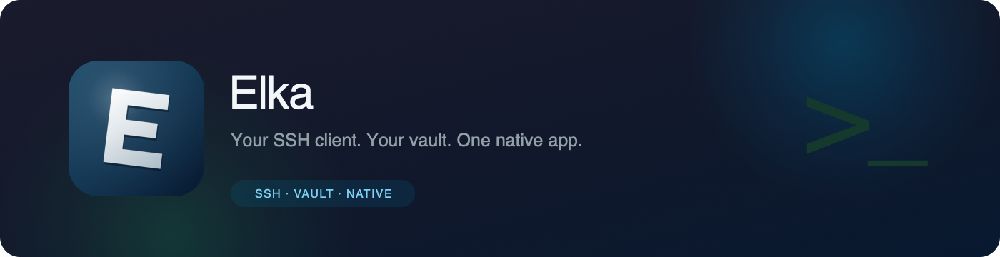

<div align="center">
  
  <h1>Elka</h1>
  <p><strong>An encrypted SSH client that keeps everything on your machine.</strong></p>

  <p>
    <a href="README.md">English</a> ·
    <a href="README.ru.md">Русский</a>
  </p>

  <p>
    <a href="../../releases"></a>
    
    
    
    
    
    
    
  </p>
</div>

> **Local vault. Native UI. No Electron.**
>
> Hosts, keys, credentials and groups live in an encrypted SQLite vault on your disk. Elka opens terminals, chains jump hosts, forwards ports and browses SFTP — all in one native window.

<p align="center">
  
  &nbsp;
  
</p>

## Highlights

| Encrypted vault | Terminals that fit | Files and forwarding |
| --- | --- | --- |
| Hosts, keys and credentials in SQLite, sealed with AES-256-GCM and an Argon2id-derived key. | Up to eight resizable panes, tab groups, drag-and-drop layout and per-server metrics. | Built-in SFTP browser plus local and remote port forwarding from the terminal tab. |

| Make it yours | Import and update | Built to stay out of the way |
| --- | --- | --- |
| Dark and light palettes, blue and green accents, custom accent colour, 25 UI fonts, terminal font and cursor. | Tabby host import/export and in-app updates checked against GitHub releases. | Go and React with a native Wails window. No browser runtime bundled into the app. |

## What it does

- **Encrypted storage.** Hosts, groups, keys and credentials are stored in SQLite and encrypted with AES-256-GCM; the key is derived from your password with Argon2id.
- **Connections.** Plain SSH, jump-host chains, and local or remote port forwarding.
- **Terminal.** xterm.js, up to eight panes with adjustable sizes, tab groups, and layouts restored when you switch sections.
- **Files.** An SFTP browser built into the terminal tab.
- **Import and export.** Tabby format, including profile metadata.
- **Appearance.** Dark and light palettes, blue and green accents, a custom accent colour, separate interface and terminal fonts, and a terminal cursor style.
- **Two languages.** English and Russian.
- **Updates.** Releases built and published from a tag, and new-version checks against GitHub tags in Settings.
- **Server metrics.** For the active tab in the sidebar: CPU load, load average, disk wait and memory, refreshed once a second.
- **Portable vault.** The folder that holds the database can be moved anywhere on disk.

<p align="center">
  
</p>

## Where it comes from

Elka grew out of [Terminator](https://github.com/terminator-ssh/terminator-desktop), an open-source SSH client that was itself inspired by Termius. Its architecture is the starting point: Wails v3, a Go backend, encrypted SQLite and Velopack for installers.

What Elka adds:

- splitting the terminal into panes and draggable tab groups;
- Tabby host import and export;
- appearance settings: palettes, accent colour, twenty-five fonts, terminal font and cursor;
- its own SFTP browser and port forwarding;
- its own name, icon and update system.

## Install

1. Open the [Releases](../../releases) page.
2. Download the installer for your platform:
   - **macOS** — `.pkg` (Apple Silicon);
   - **Windows** — `.exe` setup or portable `.zip`;
   - **Linux** — `.AppImage`.
3. Install and launch the app.

The macOS build is ad-hoc signed. If macOS blocks the first launch, right-click the app and choose **Open**.

## Build

Requirements: Go 1.25+, Node.js 24+, pnpm, and the [Wails v3 CLI](https://v3.wails.io/getting-started/installation/).

```sh
wails3 dev              # development
wails3 task package     # production build for the current platform
```

macOS can be built in Docker without installing dependencies locally:

```sh
./build-macos-in-docker.sh --arch arm64 --format dmg
```

Use `amd64` for Intel. Without the `--format` flag only the `.app` is produced.

Debug with delve:

```sh
dlv debug --headless --listen=:2345 ./backend/cmd/elka-desktop -- dev
```

## Architecture

- **Wails v3** shell with a native webview window
- **Go** backend for SSH, SFTP, storage, settings and updates
- **React 19 + TypeScript + Vite** front end
- **xterm.js** terminals
- **SQLite** with AES-256-GCM encryption and Argon2id key derivation
- **Velopack (`vpk`)** installers; GitHub Actions builds and publishes releases from a tag

## Where the data lives

Settings and the database live in `~/Library/Application Support/Elka` on macOS, `%AppData%\Elka` on Windows, and `~/.config/Elka` on Linux.

## Project map

A module-by-module guide to where the interface, connections and storage are implemented: [PROJECT_MAP_RU.md](PROJECT_MAP_RU.md).

## Development checks

```sh
go test ./backend/internal/services/... ./backend/cmd/elka-desktop/...
go vet ./backend/internal/services/...
cd frontend && pnpm run build
```

## License

AGPL-3.0. See [LICENSE](LICENSE).

## Thanks

The authors of [Terminator](https://github.com/terminator-ssh/terminator-desktop).

<p align="center">
  
</p>
