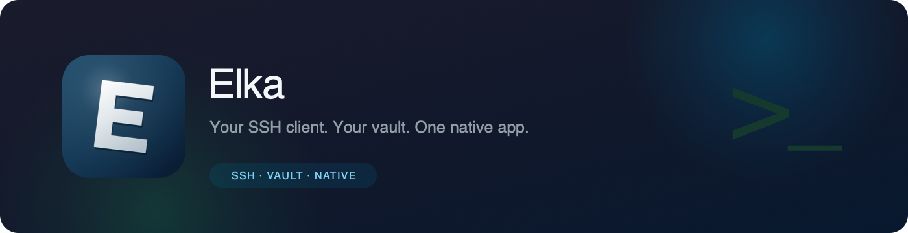

<div align="center">
  
  <h1>Elka</h1>
  <p><strong>SSH-клиент с шифрованным хранилищем, которое остаётся на вашей машине.</strong></p>

  <p>
    <a href="README.md">English</a> ·
    <a href="README.ru.md">Русский</a>
  </p>

  <p>
    <a href="../../releases"></a>
    
    
    
    
    
    
    
  </p>
</div>

> **Локальное хранилище. Нативный интерфейс. Без Electron.**
>
> Хосты, ключи, учётные данные и группы лежат в зашифрованной SQLite прямо на вашем диске. Elka открывает терминалы, строит цепочки jump-хостов, пробрасывает порты и работает с SFTP — всё в одном нативном окне.

<p align="center">
  
  &nbsp;
  
</p>

## Возможности

| Шифрованное хранилище | Терминалы под вашу задачу | Файлы и переадресация |
| --- | --- | --- |
| Хосты, ключи и учётные данные в SQLite, защищённые AES-256-GCM с ключом из Argon2id. | До восьми панелей с регулируемым размером, группы вкладок, перетаскивание раскладки и показатели сервера. | Встроенный SFTP-браузер, локальная и удалённая переадресация портов из вкладки терминала. |

| Сделайте под себя | Импорт и обновления | Не мешает работе |
| --- | --- | --- |
| Тёмная и светлая палитры, синий и зелёный акценты, свой цвет, 25 шрифтов интерфейса, шрифт и курсор терминала. | Импорт и экспорт хостов в формате Tabby, проверка новых версий по релизам GitHub прямо в настройках. | Go и React в нативном окне Wails. Браузерный рантайм в приложение не встроен. |

## Что умеет приложение

- **Шифрованное хранилище.** Хосты, группы, ключи и учётные данные лежат в SQLite и защищены AES-256-GCM; ключ выводится из пароля через Argon2id.
- **Подключения.** Обычный SSH, цепочки jump-хостов, локальная и удалённая переадресация портов.
- **Терминал.** xterm.js, до восьми панелей на экране с регулируемыми размерами, группы вкладок, восстановление раскладки при переключении разделов.
- **Файлы.** Встроенный SFTP-браузер прямо из вкладки терминала.
- **Импорт и экспорт.** Формат Tabby, включая перенос метаданных профилей.
- **Внешний вид.** Тёмная и светлая палитры, синяя и зелёная, свой акцент, отдельные шрифт интерфейса и терминала, размер и стиль курсора.
- **Два языка.** Русский и английский.
- **Обновления.** Сборка и публикация релизов по тегу, проверка новых версий по тегам GitHub прямо в настройках.
- **Показатели сервера.** Для активной вкладки в боковом меню: нагрузка, load average, ожидание диска и память, обновление раз в секунду.
- **Своё хранилище.** Папку с базой можно перенести в любое место диска.

<p align="center">
  
</p>

## Откуда

Проект вырос из [Terminator](https://github.com/terminator-ssh/terminator-desktop) — открытого SSH-клиента, который сам вдохновлён Termius. За основу взята его архитектура: Wails v3, Go в бэкенде, SQLite с шифрованием, Velopack для сборки установочных пакетов.

Важные функции терминала, которые добавлены в Elka:

- разделение терминала на панели и группы вкладок с перетаскиванием;
- импорт и экспорт хостов в формате Tabby;
- настройки внешнего вида: палитры, акцентный цвет, двадцать пять шрифтов, шрифт и курсор терминала;
- собственный SFTP-браузер и переадресация портов;
- своё имя, своя иконка и своя система обновлений.

## Установка

1. Откройте страницу [Releases](../../releases).
2. Скачайте установщик для своей платформы:
   - **macOS** — `.pkg` (Apple Silicon);
   - **Windows** — установщик `.exe` или переносимый `.zip`;
   - **Linux** — `.AppImage`.
3. Установите и запустите приложение.

Сборка для macOS подписана ad-hoc. Если macOS блокирует первый запуск, нажмите на приложение правой кнопкой и выберите **Открыть**.

## Сборка

Нужны Go 1.25+, Node.js 24+, pnpm и [Wails v3 CLI](https://v3.wails.io/getting-started/installation/).

```sh
wails3 dev              # разработка
wails3 task package     # сборка приложения под текущую платформу
```

macOS можно собрать в Docker, не ставя зависимости локально:

```sh
./build-macos-in-docker.sh --arch arm64 --format dmg
```

Для Intel вместо `arm64` укажите `amd64`. Без флага `--format` соберётся только `.app`.

Отладка с delve:

```sh
dlv debug --headless --listen=:2345 ./backend/cmd/elka-desktop -- dev
```

## Архитектура

- **Wails v3** — нативное окно с webview
- **Go** — бэкенд для SSH, SFTP, хранилища, настроек и обновлений
- **React 19 + TypeScript + Vite** — интерфейс
- **xterm.js** — терминалы
- **SQLite** с шифрованием AES-256-GCM и ключом из Argon2id
- **Velopack (`vpk`)** — установщики; GitHub Actions собирает и публикует релизы по тегу

## Где лежат данные

Настройки и база хранятся в `~/Library/Application Support/Elka` на macOS, в `%AppData%\Elka` на Windows и в `~/.config/Elka` на Linux.

## Карта проекта

Путеводитель по модулям: что править при изменении интерфейса, подключений или хранилища — [PROJECT_MAP_RU.md](PROJECT_MAP_RU.md).

## Проверки при разработке

```sh
go test ./backend/internal/services/... ./backend/cmd/elka-desktop/...
go vet ./backend/internal/services/...
cd frontend && pnpm run build
```

## Лицензия

AGPL-3.0. См. [LICENSE](LICENSE).

## Благодарности

Авторам [Terminator](https://github.com/terminator-ssh/terminator-desktop).

<p align="center">
  
</p>
